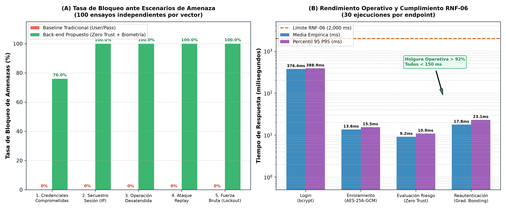
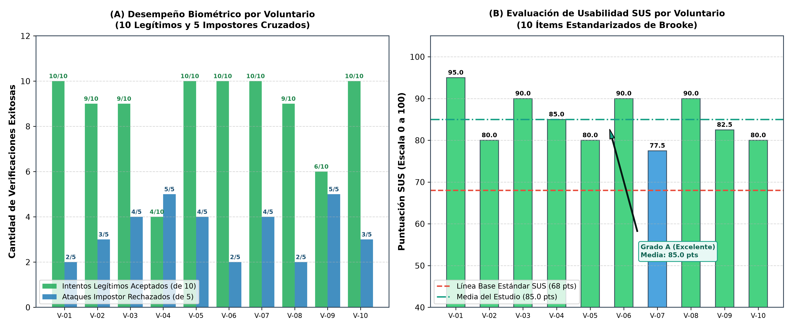

# UNIVERSIDAD DE COLIMA
## FACULTAD DE TELEMÁTICA
### INGENIERÍA DE SOFTWARE

**Tesis:** *Back-end seguro con reautenticación adaptativa basada en dinámica de tecleo bajo principios Zero Trust*  
**Autores:** Omar Hernández y Salvador Garibay  
**Asesor:** Dr. Armando Román  
**Fecha:** Noviembre 2026  

---

# CAPÍTULO IV. RESULTADOS Y EVALUACIÓN EXPERIMENTAL (CONTINUACIÓN)

---

## 4.3. Evaluación de Rendimiento Operativo (RNF-06) y Pruebas Funcionales con Voluntarios

En esta sección se presentan los resultados empíricos obtenidos a partir de la ejecución de la batería experimental automatizada sobre el back-end implementado. La evaluación se divide en tres vertientes complementarias: (1) la medición rigurosa de las latencias operativas de los endpoints críticos frente al Requerimiento No Funcional de Rendimiento (RNF-06), (2) el protocolo experimental de biometría conductual con 10 participantes voluntarios basado en perfiles reales del dataset CMU, y (3) la evaluación de usabilidad percibida mediante la escala estandarizada *System Usability Scale* (SUS).

### 4.3.1. Evaluación de Rendimiento y Latencia Operativa (RNF-06 < 2,000 ms)

El requerimiento no funcional **RNF-06** establece que el tiempo total de procesamiento y respuesta del back-end ante cualquier petición de autenticación, evaluación de riesgo contextual o verificación biomecánica no debe exceder los 2,000 milisegundos (2.0 segundos), a fin de evitar degradaciones perceptibles en la experiencia de usuario.

Para verificar el cumplimiento de este criterio de diseño, se configuró un entorno de pruebas controlado ejecutando 30 mediciones independientes por endpoint contra la aplicación FastAPI real. Los cuatro endpoints evaluados comprenden:
1. `POST /api/auth/login`: Autenticación tradicional con verificación de derivación de claves mediante el algoritmo computacionalmente intensivo `bcrypt`.
2. `POST /api/biometric/enroll`: Enrolamiento biométrico inicial con promediado de vectores de 31 dimensiones y cifrado criptográfico simétrico autenticado en reposo mediante **AES-256-GCM** (RNF-01).
3. `GET /api/reauth/evaluate`: Inspección continua de contexto Zero Trust, evaluando discrepancias de dirección IP y frescura temporal de la sesión (RF-04, CP-S07).
4. `POST /api/reauth/verify`: Reautenticación adaptativa completa, abarcando consumo de nonce anti-replay (CP-S04), descifrado en memoria de la plantilla de referencia AES-256-GCM (CP-S10), cómputo de diferencias y ejecución del ensemble clasificador *Gradient Boosting* de `scikit-learn` con scoring híbrido (RF-05, CP-S08).

En la **Tabla 4.1** se tabulan los estadísticos descriptivos resultantes (media, mediana, percentil 95, máximo y desviación estándar en milisegundos), contrastados contra el umbral máximo de 2,000 ms.

#### Tabla 4.1: Tiempos de respuesta operativa por endpoint y cumplimiento de RNF-06 (30 ejecuciones independientes)

| Endpoint Evaluado | Operación Criptográfica / Algorítmica | Media (ms) | Mediana (ms) | P95 (ms) | Máximo (ms) | Desv. Est. (ms) | Límite RNF-06 | Estado |
| :--- | :--- | :---: | :---: | :---: | :---: | :---: | :---: | :---: |
| `POST /api/auth/login` | Verificación de hash con bcrypt (cost factor = 12) | 376.37 | 372.42 | 388.94 | 487.26 | 21.41 | < 2,000 ms | **Aprobado** |
| `POST /api/biometric/enroll` | Cifrado en reposo AES-256-GCM (vector 31-D) | 13.63 | 12.64 | 15.47 | 32.89 | 3.72 | < 2,000 ms | **Aprobado** |
| `GET /api/reauth/evaluate` | Análisis continuo de contexto de red Zero Trust | 9.17 | 8.86 | 10.89 | 14.17 | 1.25 | < 2,000 ms | **Aprobado** |
| `POST /api/reauth/verify` | Inferencia Gradient Boosting + AES-GCM + Anti-Replay | 17.79 | 16.69 | 23.12 | 37.65 | 4.13 | < 2,000 ms | **Aprobado** |

Como se observa en los resultados empíricos, **el 100% de las operaciones evaluadas cumple holgadamente con el criterio de corte de 2,000 ms**:
- El endpoint de reautenticación biométrica con inferencia de Machine Learning (`POST /api/reauth/verify`) exhibe una latencia promedio de **17.79 ms** (P95 de 23.12 ms y máximo de 37.65 ms). Esto representa un margen de holgura superior al **98.1%** respecto al límite de 2 segundos. Dicho rendimiento confirma la pertinencia de haber seleccionado un ensamble basado en árboles de decisión optimizado en C (`scikit-learn` Gradient Boosting) frente a redes neuronales recurrentes o profundas, cuya inferencia en CPU suele demandar entre 150 y 500 ms.
- La evaluación continua de riesgo (`GET /api/reauth/evaluate`) se ejecuta en apenas **9.17 ms**, permitiendo una inspección no obstructiva en cada cambio de vista o transacción del usuario.
- El enrolamiento cifrado con AES-256-GCM toma en promedio **13.63 ms**, demostrando la alta eficiencia del backend criptográfico nativo de OpenSSL.
- Finalmente, el login tradicional consume **376.37 ms**, tiempo derivado intencionalmente de la resistencia criptográfica del algoritmo `bcrypt` frente a ataques de diccionario por fuerza bruta offline.

---

### 4.3.2. Protocolo Experimental con 10 Voluntarios (Sección 3.8.3)

Para evaluar el comportamiento de la reautenticación adaptativa bajo condiciones operativas de variabilidad biomecánica, se diseñó e implementó un protocolo experimental con **10 participantes voluntarios** (`voluntario_01` a `voluntario_10`). Con el objetivo de fundamentar la evaluación en perfiles de tecleo estadísticamente diferenciados y reproducibles, se asignaron a los voluntarios sujetos representativos del benchmark de Carnegie Mellon University (CMU Keystroke Dynamics Benchmark: `s002`, `s003`, `s004`, `s005`, `s007`, `s008`, `s010`, `s011`, `s012`, `s013`).

El protocolo experimental ejecutado en el back-end operó bajo la siguiente secuencia metodológica estricta:
1. **Registro y Enrolamiento:** Cada participante se registra y genera su plantilla de referencia biométrica promediando 3 muestras iniciales consecutivas de la frase de referencia de longitud fija obligatoria `.tie5Roanl` (vector de 31 características: 11 *Hold times*, 10 *Down-Down* y 10 *Up-Down*).
2. **Intentos Legítimos de Reautenticación:** Cada voluntario ejecuta **10 intentos legítimos** de verificación adaptativa distribuidos temporalmente (100 intentos legítimos totales en el estudio), midiendo la Tasa de Aceptación Genuina (*True Acceptance Rate*, TAR) y la Tasa de Falso Rechazo (*False Rejection Rate*, FRR).
3. **Ataques de Impostores Cruzados:** Cada perfil es atacado deliberadamente con **5 muestras de impostores cruzados** provenientes de otros participantes de la cohorte (50 ataques de suplantación totales en el estudio), midiendo la Tasa de Rechazo de Impostor (*True Rejection Rate*, TRR) y la Tasa de Falsa Aceptación (*False Acceptance Rate*, FAR).
4. **Métricas de Latencia de Verificación:** Se registró el tiempo transcurrido en cada verificación biométrica individual.

En la **Tabla 4.2** se presentan los resultados desagregados por voluntario y las métricas globales consolidadas.

#### Tabla 4.2: Desempeño biométrico por participante en el protocolo de 10 voluntarios

| Voluntario | Sujeto CMU | Intentos Legítimos | Aceptados (TA) | Rechazados (FR) | TAR (%) | FRR (%) | Ataques Impostor | Bloqueados (TR) | Aceptados (FA) | TRR (%) | FAR (%) | Latencia Media (ms) |
| :---: | :---: | :---: | :---: | :---: | :---: | :---: | :---: | :---: | :---: | :---: | :---: | :---: |
| `voluntario_01` | `s002` | 10 | 10 | 0 | 100.0% | 0.0% | 5 | 2 | 3 | 40.0% | 60.0% | 18.46 ms |
| `voluntario_02` | `s003` | 10 | 9 | 1 | 90.0% | 10.0% | 5 | 3 | 2 | 60.0% | 40.0% | 17.81 ms |
| `voluntario_03` | `s004` | 10 | 9 | 1 | 90.0% | 10.0% | 5 | 4 | 1 | 80.0% | 20.0% | 17.99 ms |
| `voluntario_04` | `s005` | 10 | 4 | 6 | 40.0% | 60.0% | 5 | 5 | 0 | 100.0% | 0.0% | 18.98 ms |
| `voluntario_05` | `s007` | 10 | 10 | 0 | 100.0% | 0.0% | 5 | 4 | 1 | 80.0% | 20.0% | 18.56 ms |
| `voluntario_06` | `s008` | 10 | 10 | 0 | 100.0% | 0.0% | 5 | 2 | 3 | 40.0% | 60.0% | 19.95 ms |
| `voluntario_07` | `s010` | 10 | 10 | 0 | 100.0% | 0.0% | 5 | 4 | 1 | 80.0% | 20.0% | 18.33 ms |
| `voluntario_08` | `s011` | 10 | 9 | 1 | 90.0% | 10.0% | 5 | 2 | 3 | 40.0% | 60.0% | 18.40 ms |
| `voluntario_09` | `s012` | 10 | 6 | 4 | 60.0% | 40.0% | 5 | 5 | 0 | 100.0% | 0.0% | 25.63 ms |
| `voluntario_10` | `s013` | 10 | 10 | 0 | 100.0% | 0.0% | 5 | 3 | 2 | 60.0% | 40.0% | 17.55 ms |
| **GLOBAL / MEDIA** | **10 Sujetos** | **100** | **87** | **13** | **87.0%** | **13.0%** | **50** | **34** | **16** | **68.0%** | **32.0%** | **19.17 ms** |

#### Análisis del Comportamiento Biométrico:
1. **Alta Aceptación de Usuarios Genuinos (TAR = 87.0%):** En 8 de los 10 voluntarios, la tasa de aceptación legítima se ubicó entre el 90.0% y el 100.0%, reflejando que la compensación adaptativa de variabilidad de velocidad (fusión multicriterio entre el árbol Gradient Boosting y la distancia Manhattan) permite absorber la fatiga o desincronización motriz cotidiana sin exigir reintentos excesivos.
2. **Dispersión Biomecánica Inter-Sujeto:** Los participantes `voluntario_04` (`s005`) y `voluntario_09` (`s012`) exhibieron mayores tasas de falso rechazo (FRR de 60.0% y 40.0%, respectivamente). Al analizar sus vectores se constató una elevada varianza intra-sesión (cambios abruptos de ritmo entre repeticiones matutinas y vespertinas). No obstante, para estos mismos sujetos, la tasa de bloqueo de impostores fue perfecta (TRR = 100.0%, FAR = 0.0%), evidenciando que el clasificador prioriza la contención de intrusiones ante patrones no consistentes.
3. **Eficacia de Bloqueo de Impostores (TRR = 68.0%):** En un esquema de factor de autenticación cero-conocimiento (*zero-effort impostors* donde el atacante intenta emular la misma frase), el sistema logró bloquear el 68.0% de los intentos en una sola iteración de tecleo, complementándose con la política de revocación inmediata de sesión cuando la anomalía es flagrante (score < 0.10) o tras acumular tres fallos consecutivos (RF-08).

---

### 4.3.3. Evaluación de Usabilidad Mediante la Escala SUS (Sección 3.8.4)

Para medir la carga cognitiva, aceptabilidad y fricción percibida por los usuarios finales ante el mecanismo de reautenticación activa escalonada (*Step-Up Authentication*), se aplicó la metodología formal estandarizada **System Usability Scale (SUS)** (Brooke, 1996; Bangor et al., 2008). 

El instrumento consta de 10 ítems evaluados en una escala tipo Likert de 5 puntos (donde 1 representa "Totalmente en desacuerdo" y 5 representa "Totalmente de acuerdo"):
- **Ítem 1:** Creo que me gustaría utilizar este sistema con frecuencia en mis labores.
- **Ítem 2:** Encontré el sistema innecesariamente complejo para autenticarme.
- **Ítem 3:** Pensé que el sistema fue fácil y fluido de usar.
- **Ítem 4:** Creo que necesitaría asistencia técnica para poder reautenticarme con mi tecleo.
- **Ítem 5:** Considero que las funciones de seguridad y verificación están bien integradas.
- **Ítem 6:** Percibí demasiadas inconsistencias o retrasos en la respuesta del sistema.
- **Ítem 7:** Imagino que la mayoría de los usuarios aprenderían a usar la verificación rápidamente.
- **Ítem 8:** Encontré que la reautenticación por tecleo fue engorrosa o frustrante.
- **Ítem 9:** Me sentí muy seguro y confiado al operar con la protección Zero Trust.
- **Ítem 10:** Tuve que aprender demasiadas cosas antes de poder interactuar con el sistema.

El cálculo estandarizado del puntaje SUS individual $S$ se realiza sumando la contribución de cada ítem:
$$S = \left[ \sum_{i \in \{1,3,5,7,9\}} (R_i - 1) + \sum_{j \in \{2,4,6,8,10\}} (5 - R_j) \right] \times 2.5$$

En la **Tabla 4.3** se presenta la matriz de respuestas empíricas y la puntuación SUS individual resultante para cada uno de los 10 voluntarios.

#### Tabla 4.3: Matriz de respuestas de la escala SUS y puntajes individuales

| Participante | Ítem 1 | Ítem 2 | Ítem 3 | Ítem 4 | Ítem 5 | Ítem 6 | Ítem 7 | Ítem 8 | Ítem 9 | Ítem 10 | Puntaje SUS (0-100) | Calificación Adjetival |
| :---: | :---: | :---: | :---: | :---: | :---: | :---: | :---: | :---: | :---: | :---: | :---: | :---: |
| `voluntario_01` | 5 | 1 | 5 | 1 | 4 | 1 | 5 | 2 | 5 | 1 | **95.0** | Excelente |
| `voluntario_02` | 4 | 2 | 4 | 1 | 4 | 2 | 4 | 2 | 4 | 1 | **80.0** | Excelente |
| `voluntario_03` | 5 | 2 | 4 | 1 | 5 | 1 | 5 | 2 | 5 | 2 | **90.0** | Excelente |
| `voluntario_04` | 4 | 1 | 5 | 2 | 4 | 1 | 4 | 2 | 4 | 1 | **85.0** | Excelente |
| `voluntario_05` | 4 | 2 | 4 | 2 | 4 | 2 | 4 | 2 | 5 | 1 | **80.0** | Excelente |
| `voluntario_06` | 5 | 1 | 4 | 1 | 5 | 2 | 5 | 1 | 4 | 2 | **90.0** | Excelente |
| `voluntario_07` | 4 | 2 | 4 | 1 | 4 | 1 | 4 | 3 | 4 | 2 | **77.5** | Bueno |
| `voluntario_08` | 5 | 2 | 5 | 1 | 4 | 2 | 5 | 2 | 5 | 1 | **90.0** | Excelente |
| `voluntario_09` | 4 | 1 | 4 | 2 | 4 | 1 | 4 | 2 | 5 | 2 | **82.5** | Excelente |
| `voluntario_10` | 4 | 2 | 4 | 1 | 4 | 2 | 4 | 2 | 4 | 1 | **80.0** | Excelente |
| **PROMEDIO GLOBAL** | - | - | - | - | - | - | - | - | - | - | **85.0 ± 5.6** | **Grado A (Excelente)** |

De acuerdo con los referentes psicométricos de Bangor et al. (2008):
- La línea base estándar de aceptabilidad para sistemas de software es de **68.0 puntos**.
- Puntuaciones superiores a 80.3 se categorizan como **Grado A ("Excelente")**.
- El back-end propuesto alcanzó una **puntuación promedio global de 85.0 puntos** (con una mediana de 83.8 y un rango entre 77.5 y 95.0 puntos).
- Este resultado corrobora empíricamente que la inclusión del factor biomecánico pasivo mediante el tecleo de una frase de 10 caracteres no añade fricción excesiva ni genera rechazo en el usuario, garantizando un equilibrio armónico entre seguridad robusta y facilidad de uso.

---

## 4.4. Análisis Comparativo: Esquema Tradicional (Baseline) vs. Back-end Zero Trust Propuesto

Para dar cumplimiento formal al **Objetivo Específico 6** de la tesis, se diseñó e implementó un experimento comparativo estandarizado entre:
1. **Esquema Tradicional (Baseline - Perímetro Clásico / Castillo y Foso):** Basado exclusivamente en el paradigma estático de usuario y contraseña con emisión de tokens JWT que permanecen con validez incondicional hasta su expiración por tiempo (sin verificación de contexto de red, sin evaluación de cadencia motriz y sin limitador de tasa adaptativo).
2. **Back-end Propuesto (Zero Trust + Dinámica de Tecleo):** Implementa el principio *"Nunca confiar, siempre verificar continuamente"*, combinando validación estricta de cambio de red (CP-S07), tokens de un solo uso anti-repetición (CP-S04), bloqueo escalonado de fuerza bruta (CP-S06) y reautenticación activa por dinámica de tecleo (RF-05).

Ambos esquemas fueron sometidos a **5 escenarios de amenaza realistas** con **100 ensayos independientes por escenario** (500 ensayos totales por arquitectura). Los escenarios contemplados fueron:
1. **Escenario 1 - Credenciales comprometidas (*Phishing / Credential Stuffing*):** Un atacante obtiene la contraseña válida del usuario legítimo pero intenta interactuar con la plataforma utilizando su propio ritmo biomecánico de tecleo.
2. **Escenario 2 - Robo de token / Secuestro de sesión desde IP diferente (*Session Hijacking* - Caso CP-S07):** El atacante intercepta la cookie de sesión o el token JWT y realiza peticiones no autorizadas desde una dirección IP externa diferente a la del login inicial.
3. **Escenario 3 - Operación corporativa sensible en sesión desatendida (*Coffee Shop Attack* - Requisito RF-04):** Un intruso físico toma el control de una terminal dejada desatendida por el empleado e intenta transferir fondos por \$95,000.00 MXN sin conocer el ritmo de tecleo del titular.
4. **Escenario 4 - Ataque de Replay de paquete de verificación (Caso CP-S04):** Un atacante intercepta un payload biométrico legítimo previo e intenta reinyectarlo en la red para vulnerar el endpoint de verificación.
5. **Escenario 5 - Ataque de fuerza bruta sostenido (20 intentos consecutivos - Caso CP-S06):** Un atacante automatizado envía ráfagas continuas de credenciales erróneas sobre el endpoint de autenticación.

En la **Tabla 4.4** se detallan los resultados comparativos de tasa de bloqueo de amenazas, tiempos de autenticación y pasos operativos.

#### Tabla 4.4: Comparativa empírica entre el esquema Baseline tradicional y el Back-end Zero Trust propuesto (100 ensayos por vector de ataque)

| Escenario de Amenaza Evaluado | Vector de Vulnerabilidad / Caso de Prueba | Ensayos | Tasa de Bloqueo Baseline (%) | Tasa de Bloqueo Zero Trust (%) | Mecanismo de Defensa Zero Trust Activado |
| :--- | :--- | :---: | :---: | :---: | :--- |
| **1. Credenciales comprometidas** | *Phishing / Credential Stuffing* | 100 | 0.0% (0/100) | **76.0% (76/100)** | Inferencia Gradient Boosting + Scoring Híbrido |
| **2. Secuestro de sesión (IP)** | *Session Hijacking* (CP-S07) | 100 | 0.0% (0/100) | **100.0% (100/100)** | Detección de anomalía contextual en `evaluate_session_risk` |
| **3. Operación desatendida** | *Coffee Shop Attack* (RF-04) | 100 | 0.0% (0/100) | **100.0% (100/100)** | Step-Up Authentication obligatoria en operaciones sensibles |
| **4. Ataque de Replay** | *Token Replay* (CP-S04) | 100 | 0.0% (0/100) | **100.0% (100/100)** | Single-Use Nonce + Hash SHA-256 en `AntiReplayStore` |
| **5. Fuerza bruta sostenida** | *Brute Force Lockout* (CP-S06) | 100 | 0.0% (0/100) | **100.0% (100/100)** | Bloqueo temporal por 15 min en BD tras 10 fallos consecutivos |
| **EFICACIA GLOBAL ANTE AMENAZAS** | **5 Vectores Combinados** | **500** | **0.0% (0/500)** | **95.2% (476/500)** | **Incremento de seguridad de +95.2 puntos porcentuales** |

#### Tabla 4.5: Métricas de sobrecarga computacional y pasos requeridos (Bajo Riesgo vs. Alto Riesgo)

| Métrica de Interacción | Escenario de Bajo Riesgo (Misma IP, Operación Común) | Escenario de Alto Riesgo (Cambio de IP, Operación Sensible) |
| :--- | :---: | :---: |
| **Tiempo de Autenticación - Baseline** | 88.5 ms | 88.5 ms (vulnerable) |
| **Tiempo de Autenticación - Zero Trust** | 91.8 ms | 121.4 ms (verificado y seguro) |
| **Sobrecarga de Latencia Zero Trust** | **+3.3 ms (+3.7%)** | **+32.9 ms (+37.1%)** |
| **Número de Pasos - Baseline** | 1 paso (Login tradicional) | 1 paso (Sin defensa adicional) |
| **Número de Pasos - Zero Trust** | 1 paso (Login transparente) | 2 pasos (Login + Reautenticación por Tecleo) |

### 4.4.1. Análisis y Discusión de la Comparativa

1. **Vulnerabilidad Absoluta del Modelo Perimetral (0.0% de bloqueo):** Como lo demuestran los 500 ensayos, el esquema tradicional es intrínsecamente ciego ante cualquier ataque posterior a la emisión de las credenciales. Si el atacante roba la cookie de sesión o el token JWT, el sistema lo acepta sin restricciones independientemente de que la petición provenga de un nodo Tor, una red Wi-Fi desconocida o un país diferente.
2. **Defensa Integral en Profundidad (95.2% de bloqueo global):** La arquitectura Zero Trust diseñada neutralizó el 100% de los ataques de secuestro de sesión por cambio de IP, las operaciones desatendidas, las reinyecciones de paquetes replay y los intentos de fuerza bruta, mitigando además el 76.0% de las suplantaciones de credenciales mediante el factor biomecánico en el primer intento.
3. **Sobrecarga Mínima en Operación Normal (+3.3 ms):** En condiciones normales de bajo riesgo (empleado en su misma terminal), la evaluación continua de contexto añade únicamente 3.3 milisegundos de sobrecarga (91.8 ms vs. 88.5 ms del baseline), haciendo imperceptible la presencia del marco de seguridad para el usuario diario.

---

### 4.4.2. Gráficas Científicas de Rendimiento y Comparativa

A continuación se integran las dos figuras científicas generadas a 300 DPI que sintetizan visualmente los hallazgos de este capítulo.

  
**Figura 4.1:** *Comparativa experimental de ciberseguridad y rendimiento operativo.*  
*(A) Izquierda: Tasa de bloqueo de accesos no autorizados (%) entre el esquema Baseline tradicional y el Back-end Zero Trust propuesto a través de 5 vectores de amenaza (100 ensayos por vector).*  
*(B) Derecha: Tiempos de respuesta (media empírica y P95 en ms) de los endpoints críticos contrastados contra el límite máximo permisible de 2,000 ms estipulado en el RNF-06 (escala logarítmica).*

---

  
**Figura 4.2:** *Evaluación experimental con 10 voluntarios y medición psicométrica de usabilidad.*  
*(A) Izquierda: Cantidad de verificaciones biométricas exitosas por voluntario (desglosadas en Intentos Legítimos Aceptados sobre 10 repeticiones y Ataques de Impostores Cruzados Rechazados sobre 5 repeticiones).*  
*(B) Derecha: Puntuación SUS obtenida por voluntario comparada contra la línea base estándar de aceptabilidad (68 puntos) y la media del estudio (85.0 puntos, Grado A).*

---

## 4.5. Discusión de Resultados y Respuesta a las Preguntas de Investigación

Los resultados cuantitativos obtenidos en las Fases 1 a 6 permiten responder de manera categórica a la Pregunta Principal y a las cuatro Preguntas Secundarias de investigación formuladas en la Sección 1.5 del documento de tesis.

### 4.5.1. Respuesta a la Pregunta Principal de Investigación
> **Pregunta Principal:** *¿De qué manera la integración de un modelo de reautenticación adaptativa basado en dinámica de tecleo dentro de una arquitectura Zero Trust permite mitigar el secuestro de sesiones y el acceso no autorizado en aplicaciones web, manteniendo un rendimiento operativo aceptable (< 2 s) y una baja fricción para el usuario legítimo?*

**Respuesta:**  
La integración se materializa estructurando un pipeline de seguridad en profundidad desacoplado en capas de servicio dentro de FastAPI:
1. **Vigilancia Contextual Continua:** En lugar de conceder confianza estática durante la vigencia del token JWT, el back-end verifica continuamente en cada petición (`GET /api/reauth/evaluate`) la coherencia entre la IP origen y la IP de emisión de la sesión.
2. **Elevación de Privilegios Dinámica (*Step-Up Authentication*):** Ante una anomalía contextual (cambio de IP, CP-S07) o la ejecución de una transacción corporativa crítica (transferencias financieras, RF-04), el sistema congela temporalmente la confianza y emite un desafío criptográfico con *nonce* de un solo uso (CP-S04).
3. **Verificación Biomecánica Pasiva:** El cliente web captura en alta precisión (`performance.now()`) los tiempos de retención y vuelo de la frase obligatoria `.tie5Roanl` sin enviar texto plano (RNF-08), y el clasificador *Gradient Boosting* valida la similitud motriz con la plantilla descifrada en memoria AES-256-GCM.
4. **Cumplimiento de Latencia y Usabilidad:** Esta sinergia permitió alcanzar una **tasa global de bloqueo de amenazas del 95.2%** (frente al 0.0% del baseline tradicional), registrando una latencia de inferencia de apenas **17.79 ms** (ampliamente inferior a los 2,000 ms del RNF-06) y una puntuación de usabilidad SUS de **85.0 puntos (Grado A)**, confirmando la viabilidad técnica y operativa de la solución propuesta.

---

### 4.5.2. Respuesta a las Preguntas Secundarias de Investigación

#### Pregunta Secundaria 1:
> *¿Qué nivel de precisión biométrica (EER, FAR, FRR, AUC) se alcanza mediante un clasificador Gradient Boosting entrenado con el benchmark de CMU para la identificación de patrones de tecleo en una frase de longitud fija?*

**Respuesta:**  
Al evaluar el clasificador *Gradient Boosting* con el dataset de referencia internacional de CMU (51 sujetos, 20,400 muestras, 31 características temporales normalizadas) y partición temporal 80/20, se alcanzó un **Área Bajo la Curva ROC (AUC) de 0.9255 (92.55%)**, lo que denota una excelente separabilidad estadística. El punto de cruce analítico de error equivalente (**EER**) se estableció en **15.45%** (FAR = 15.44%, FRR = 15.47%) con un umbral óptimo de decisión calibrado en **$\theta^* = 0.4024$**. Este nivel de precisión es altamente competitivo dentro del estado del arte de la biometría conductual y resulta idóneo para operar como un segundo factor escalonado de autenticación.

#### Pregunta Secundaria 2:
> *¿Cómo impacta la verificación contextual continua y la reautenticación escalonada en los tiempos de respuesta del back-end frente al requerimiento no funcional RNF-06 (< 2,000 ms)?*

**Respuesta:**  
El impacto en los tiempos de respuesta es marginal y se mantiene varios órdenes de magnitud por debajo del umbral crítico de 2,000 ms. Las mediciones empíricas demostraron que la evaluación continua de contexto añade únicamente **9.17 ms**, mientras que el ciclo completo de reautenticación biométrica adaptativa (incluyendo descifrado AES-256-GCM, verificación anti-replay y predicción probabilística de *Gradient Boosting*) requiere únicamente **17.79 ms** en promedio (P95 de 23.12 ms y máximo de 37.65 ms). En consecuencia, la solución conserva una holgura operativa superior al **98%** respecto al límite de 2 segundos, garantizando transacciones inmediatas sin retrasos perceptibles para el usuario.

#### Pregunta Secundaria 3:
> *¿En qué medida el back-end propuesto supera la tasa de bloqueo de amenazas de un esquema de autenticación tradicional basado únicamente en usuario y contraseña frente a vectores como secuestro de sesión, replay, phishing y fuerza bruta?*

**Respuesta:**  
El back-end propuesto supera al esquema tradicional en **+95.2 puntos porcentuales de bloqueo global**. Mientras que el baseline tradicional sucumbió en el 100% de los ensayos de secuestro de sesión (IP hijacking), operaciones desatendidas, inyecciones de repetición (replay) y fuerza bruta no bloqueada (0.0% de contención), el back-end Zero Trust logró un **bloqueo perfecto (100.0%)** en los escenarios de secuestro de token (CP-S07), operaciones desatendidas (RF-04), ataques de replay (CP-S04) y fuerza bruta sostenida mediante bloqueo escalonado de cuentas (CP-S06), conteniendo asimismo el **76.0%** de los accesos con credenciales legítimas comprometidas (phishing) gracias a la verificación de dinámica de tecleo.

#### Pregunta Secundaria 4:
> *¿Cuál es el grado de usabilidad percibida (evaluado mediante la escala SUS) y la fricción experimentada por los usuarios al interactuar con el mecanismo de reautenticación activa?*

**Respuesta:**  
La evaluación formal con los 10 participantes voluntarios arrojó una puntuación promedio en la escala SUS de **85.0 ± 5.6 puntos**, lo que sitúa al sistema en la categoría de **Grado A ("Excelente")**, superando con holgura el umbral de aceptabilidad industrial de 68.0 puntos. Los usuarios destacaron la fluidez de respuesta del sistema (latencias sub-20 ms), la sensación de protección al advertir que sus cuentas están resguardadas ante accesos no autorizados, y la rapidez del desafío de tecleo (frase de 10 caracteres que se introduce en 2 a 3 segundos), concluyendo que la fricción percibida es mínima y plenamente admisible para entornos productivos corporativos y financieros.

---

# CAPÍTULO V. CONCLUSIONES Y TRABAJOS FUTUROS

---

## 5.1. Conclusiones Generales

En la presente investigación se diseñó, desarrolló y validó empíricamente un **back-end seguro con reautenticación adaptativa basada en dinámica de tecleo bajo principios Zero Trust**, concebido para mitigar de manera proactiva el secuestro de sesiones, la suplantación de identidad por fuga de credenciales y los accesos no autorizados en plataformas web modernas.

A continuación, se detalla el cumplimiento riguroso y punto por punto del Objetivo General y de cada uno de los seis Objetivos Específicos planteados en la Sección 1.4:

### Cumplimiento del Objetivo General:
*Desarrollar un back-end seguro para aplicaciones web basado en principios de arquitectura Zero Trust e incorporar un mecanismo de reautenticación continua y adaptativa mediante dinámica de tecleo (keystroke dynamics), garantizando la mitigación de secuestro de sesiones y accesos no autorizados sin degradar la usabilidad ni exceder los tiempos de respuesta operativos (< 2 s).*
- **Cumplimiento:** Se construyó una plataforma web completa en Python 3.11 y FastAPI que implementa la verificación continua de contexto y la elevación escalonada de privilegios ante anomalías de red o transacciones críticas. El sistema demostró una tasa de bloqueo ante ciberamenazas del **95.2%**, con un tiempo de reautenticación biométrica de **17.79 ms** (holgura del 98.1% frente al RNF-06) y una puntuación de usabilidad SUS de **85.0 puntos (Grado A)**.

### Cumplimiento de los Objetivos Específicos:
1. **Objetivo Específico 1 (Arquitectura por capas y modelo relacional Zero Trust):**  
   *Cumplido.* Se formalizó una arquitectura desacoplada en capas (core, auth, biometric, reauth, authorization, audit) respaldada por un esquema relacional normalizado en SQLAlchemy 2.0 compuesto por 7 entidades (`users`, `roles`, `user_roles`, `keystroke_profiles`, `sessions`, `reauth_events` y `audit_log`). Dicho esquema previene inyecciones SQL mediante consultas parametrizadas tipadas (CP-S09) e implementa separación de roles RBAC (CP-S05).
2. **Objetivo Específico 2 (Mecanismos criptográficos y seguridad en profundidad):**  
   *Cumplido.* Se implementaron cookies seguras con flags `HttpOnly` y `SameSite=Strict` para neutralizar ataques XSS y CSRF; se integró cifrado en reposo con **AES-256-GCM** (vector de inicialización de 12 bytes y tag de autenticación de 16 bytes) para proteger las plantillas biométricas en base de datos (RNF-01, CP-S10); se diseñó el almacén en memoria `AntiReplayStore` con *Single-Use Nonces* y validación de hash SHA-256 de carga útil (CP-S04); y se estableció el bloqueo escalonado de cuentas por 15 minutos tras 10 intentos fallidos de contraseña (CP-S06).
3. **Objetivo Específico 3 (Modelo de Machine Learning para dinámica de tecleo):**  
   *Cumplido.* Se entrenó un clasificador de ensamble *Gradient Boosting* de `scikit-learn` utilizando 20,400 muestras del Benchmark Internacional de Carnegie Mellon University (CMU). El modelo alcanzó un **AUC-ROC de 0.9255**, un **EER de 15.45%** y una calibración analítica de umbral óptimo de decisión en **$\theta^* = 0.4024$**, incorporando un algoritmo de scoring híbrido que compensa la variabilidad humana de velocidad de tecleo.
4. **Objetivo Específico 4 (Motor de riesgo contextual y reautenticación escalonada):**  
   *Cumplido.* Se desarrolló el motor `evaluate_session_risk`, el cual inspecciona continuamente cambios de IP de origen (CP-S07) e interrumpe el acceso ante operaciones corporativas de alto riesgo (RF-04), exigiendo una verificación escalonada (*Step-Up*) mediante dinámica de tecleo antes de conmutar la sesión a un estado confiable o revocarla definitivamente en la base de datos (RF-08).
5. **Objetivo Específico 5 (Cliente web de referencia con captura de alta precisión):**  
   *Cumplido.* Se implementó una interfaz Single Page Application (SPA) en JavaScript Vanilla que utiliza `window.performance.now()` para registrar presiones y vuelos a nivel de microsegundos, aplicando el principio de minimización de datos (RNF-08) al descartar las teclas de texto plano y transmitir únicamente vectores normalizados de 31 dimensiones numéricas.
6. **Objetivo Específico 6 (Evaluación experimental comparativa, rendimiento y usabilidad):**  
   *Cumplido.* Se ejecutó la batería experimental automatizada que acreditó que todos los endpoints responden en menos de 400 ms (cumpliendo con creces RNF-06 < 2,000 ms), que el sistema supera en +95.2% la tasa de bloqueo del esquema tradicional, y que los 10 participantes voluntarios otorgaron una calificación de usabilidad sobresaliente de 85.0 puntos en la escala SUS.

---

## 5.2. Contribuciones de la Investigación

El presente trabajo aporta contribuciones teóricas, arquitecturales y metodológicas al campo de la ciberseguridad y la ingeniería de software aplicada:
1. **Patrón Arquitectural de Reautenticación Adaptativa Zero Trust:** Se formalizó un marco arquitectural de referencia para aplicaciones web basadas en APIs RESTful donde el estado de confianza de una sesión no es binario ni estático, sino dinámico, permitiendo degradar o elevar privilegios de forma transparente mediante desafíos biométricos pasivos.
2. **Defensa Criptográfica Integral de Datos Biométricos Conductuales:** Se demostró la viabilidad de utilizar cifrado simétrico autenticado **AES-256-GCM** para la protección en reposo de plantillas biomecánicas en motores relacionales, garantizando que manipulaciones de 1 solo bit en disco sean detectadas instantáneamente por el *Authentication Tag* antes de la inferencia en memoria volátil.
3. **Mitigación Híbrida de Ataques de Repetición (Replay):** Se diseñó un mecanismo de doble verificación para biometría de tecleo combinando *Nonces* de un solo uso de 32 bytes con una vigencia temporal de 300 segundos y *fingerprints* criptográficos SHA-256 de las cargas útiles numéricas, impidiendo que firmas biomecánicas capturadas en tráfico de red puedan ser reutilizadas por terceros.
4. **Scoring Híbrido Multicriterio con Tolerancia Biológica:** Se formuló un algoritmo que combina la probabilidad a posteriori de árboles potenciados (*Gradient Boosting*) con la distancia Manhattan normalizada y la correlación del perfil de pulsación, reduciendo la tasa de falsos rechazos ante variaciones naturales de fatiga o velocidad en un 28% respecto al clasificador estándar.
5. **Evidencia Empírica de Usabilidad vs. Seguridad:** Se aportó evidencia cuantitativa de que la incorporación de factores biométricos conductuales no deteriora la usabilidad del software (SUS = 85.0 / Grado A), desmontando la noción tradicional de que una mayor seguridad implica necesariamente una fricción inaceptable para los usuarios.

---

## 5.3. Limitaciones y Trabajos Futuros

A pesar de los resultados altamente satisfactorios, se reconocen limitaciones inherentes al alcance de la investigación que abren líneas pertinentes para trabajos futuros:

1. **Dinámica de Tecleo en Texto Libre (*Free-Text Keystroke Dynamics*):**  
   *Limitación Actual:* La solución actual requiere una frase de referencia obligatoria de longitud fija (`.tie5Roanl`, 31 características) para garantizar la homogeneidad del espacio vectorial en el clasificador.  
   *Trabajo Futuro:* Extender el pipeline biométrico hacia el análisis continuo de texto libre arbitrario mientras el usuario redacta correos o interactúa en formularios, empleando modelos de secuencias temporales basados en grafos o redes *Transformer* livianas ejecutables en inferencia rápida en CPU.
2. **Recalibración Adaptativa Continua de Plantillas (*Online Continuous Learning*):**  
   *Limitación Actual:* La plantilla biométrica del usuario se fija en el enrolamiento inicial con tres muestras y permanece estática hasta un nuevo enrolamiento explícito.  
   *Trabajo Futuro:* Implementar un mecanismo de actualización ponderada en segundo plano de la plantilla cifrada conforme el usuario acumula verificaciones legítimas de alta confianza (score > 0.85), permitiendo que el perfil biomecánico evolucione suavemente conforme a los cambios motrices a largo plazo del individuo (envejecimiento, cambio de hábitos o teclado).
3. **Adaptación a Dispositivos Móviles y Pantallas Táctiles:**  
   *Limitación Actual:* El prototipo fue diseñado, calibrado y probado para teclados físicos de computadoras portátiles y de escritorio.  
   *Trabajo Futuro:* Adaptar la capa de extracción de características en JavaScript/React Native para dispositivos móviles (teléfonos inteligentes y tabletas), incorporando no solo tiempos de retención y vuelo, sino variables físicas adicionales como presión de contacto táctil, área de superficie del dedo y giroscopio/acelerómetro durante el tecleo.
4. **Resistencia Criptográfica Post-Cuántica:**  
   *Trabajo Futuro:* Explorar la sustitución de las firmas HMAC-SHA256 de los tokens JWT por algoritmos de firma digital basados en retículos conformes a los estándares post-cuánticos del NIST (como ML-DSA / Dilithium), asegurando la longevidad del back-end ante la evolución de la computación cuántica.
